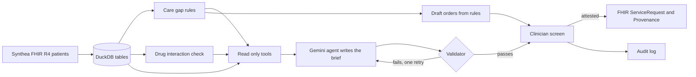

# Pre-Visit Chart Orchestrator

An AI agent that reads a diabetic patient's chart before an appointment, finds the care that is overdue, checks the medication list for risky combinations, and drafts a short brief for the doctor. The doctor reviews it, ticks a box to take responsibility, and only then do any orders get written.

**[Try the live demo](https://agentic-ehr-previsit-orchestrator-htwx7daopsd79anpmmqrcg.streamlit.app/)** (pick a patient, prepare a brief, open the sources, approve or reject).

Everything runs on **synthetic patients** made with Synthea. This is a portfolio project, not a clinical tool.

## Why I built it

Primary care doctors spend a lot of time before visits digging through charts. I wanted to see how far you can push an AI agent in a setting where being wrong has a real cost. So the design question was not "can a model summarize a chart" but "what has to be true before anyone should trust that summary".

My answer was to keep the model away from every decision that can be checked by a rule.

## How it works



1. **Data.** Synthea generates about 760 adults as FHIR R4 bundles. A loader flattens them into DuckDB tables and keeps every FHIR resource ID.
2. **Rules decide the facts.** Plain Python rules find the care gaps and the drug interactions. These are the ground truth.
3. **The model only writes.** Gemini calls three read only tools, then writes the brief as structured statements. Each statement has to cite the IDs it came from.
4. **A validator checks the model.** A brief is rejected if it cites an ID no tool returned, includes a number that appears in no tool result, names the wrong patient, or skips a tool. The model gets one retry with the problems listed. If it still fails, nobody sees the brief.
5. **Orders come from rules, not the model.** The draft orders are generated from the care gaps, so the model cannot invent one.
6. **A human signs off.** Nothing is written until a named clinician attests. Approved orders become FHIR `ServiceRequest` and `Provenance` files in a local folder, and every approval or rejection goes into an audit log.

## What the rules check

| Check | Based on | Notes |
|---|---|---|
| HbA1c above 9% | CMS122 | Uses the most recent result |
| No HbA1c in 12 months | CMS122 | A missing result counts as poor control in the measure |
| HbA1c at or above 7% | Common general target | Not a CMS measure. Real targets are set per patient |
| No diabetic eye exam in 12 months | CMS131, simplified | |
| Missing eGFR or urine albumin test in 12 months | HEDIS kidney health evaluation | Needs both labs |
| Drug interactions among active medications | Demo list from FDA labeling | See limitations |

## Results

The evaluation script scores the agent against the rules on all 82 diabetic patients. It measures care gap precision and recall, interaction precision and recall, how many briefs pass the validator on the first try, whether unknown patient IDs are refused, and whether an instruction hidden inside a medication name leaks into the output.

Baseline with the rules only writer (no AI, so this proves the plumbing, not the model):

| Check | Result |
|---|---|
| Care gaps found | 32 of 32, no false alarms |
| Interactions found | 59 of 59, no false alarms |
| Briefs that passed validation | 82 of 82 |
| Unknown or malformed patient IDs refused | 5 of 5 |
| Hidden instruction in a medication name | Did not reach orders or brief |

**Status: in progress.** The Gemini evaluation is the part still being finished. A spot check on 3 patients with the real Gemini agent passed everything (all briefs valid on the first try, no missed or invented findings, unknown IDs refused, and the hidden instruction in a medication name was ignored). Three patients is too small to report as accuracy, and the free Gemini tier allows only a handful of patients per day. The evaluation script saves its progress, so it is being run a few patients at a time until the full set of 30 is scored. Results will be added here when it is done.

```
python src/evaluate.py --llm gemini --n 30 --sleep 2 --cache eval/gemini_runs.jsonl --out eval/results_gemini.json
```

I also test that the metrics can fail. One test uses a writer that quietly drops every care gap and confirms the evaluation reports the misses.

## Limitations

I would rather say these here than have you find them.

* **Synthetic data.** Synthea's lab values are simulated. Its HbA1c results never exceed about 7.9%, so the poor control rule flags nobody in this cohort. The unit tests cover that rule with a 9.4% case instead.
* **The interaction list is a small demo set.** It has 11 pairs written from FDA labeling, not a full database. The code can load DDInter, which I did not bundle because DDInter is licensed CC BY-NC-SA 4.0. Download it yourself if you want to use it, and check the column names against the loader.
* **Simplified measures.** I use a rolling 12 month window from the visit date, not the calendar year. The eye exam rule ignores the "negative result last year" allowance. Only hospice is excluded.
* **Not clinical software.** There is no HIPAA compliance claim here because there is no real patient data. The "EHR" is a folder of JSON files standing in for a FHIR test server.
* **The validator checks citations, not medicine.** It can prove a statement points at a real record. It cannot prove the wording is clinically wise, which is why a clinician reviews everything.

## Run it on Windows

You need Python 3.10 or newer.

```
python -m venv .venv
.venv\Scripts\activate
pip install -r requirements.txt
python -m pytest -q tests
python -m streamlit run app.py
```

The app opens with a "Demo (rules only, no AI)" writer that needs no key. To use the Gemini agent, set a key in the same window before launching:

```
$env:GEMINI_API_KEY = "your-key"
```

Never commit a key. The repo ignores `.env` files.

To rebuild the patients from scratch (needs Java, about 5 GB of disk), see `scripts/generate_synthea.ps1`.

## Repository layout

```
app.py                     clinician approval screen (Streamlit)
src/load_fhir.py           FHIR bundles to DuckDB tables
src/care_gaps.py           care gap rules, documented definitions
src/interactions.py        interaction check, pluggable table
src/chart_tools.py         read only tools the agent can call
src/brief.py               brief schema, validator, draft orders
src/agent.py               Gemini agent, retry loop, refusals
src/fhir_sink.py           simulated EHR write and audit log
src/evaluate.py            scoring against the rules (resumable)
tests/                     30 tests
data/ehr_demo.duckdb       the 82 diabetic patients, ready to use
eval/                      saved evaluation results
```

## Data and licenses

* Patients: [Synthea](https://github.com/synthetichealth/synthea), Apache 2.0.
* Quality measures: CMS122 and CMS131 eCQM specifications, HEDIS kidney health evaluation.
* Interactions: demo list from FDA labeling. DDInter is supported but not included.
